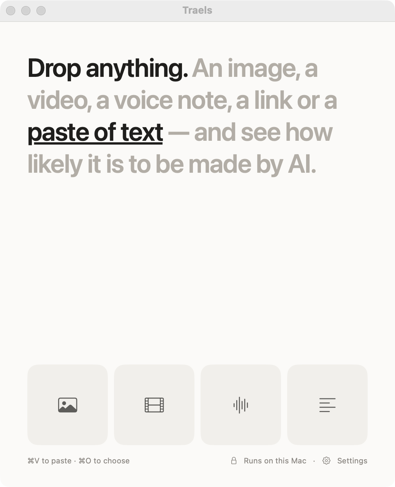
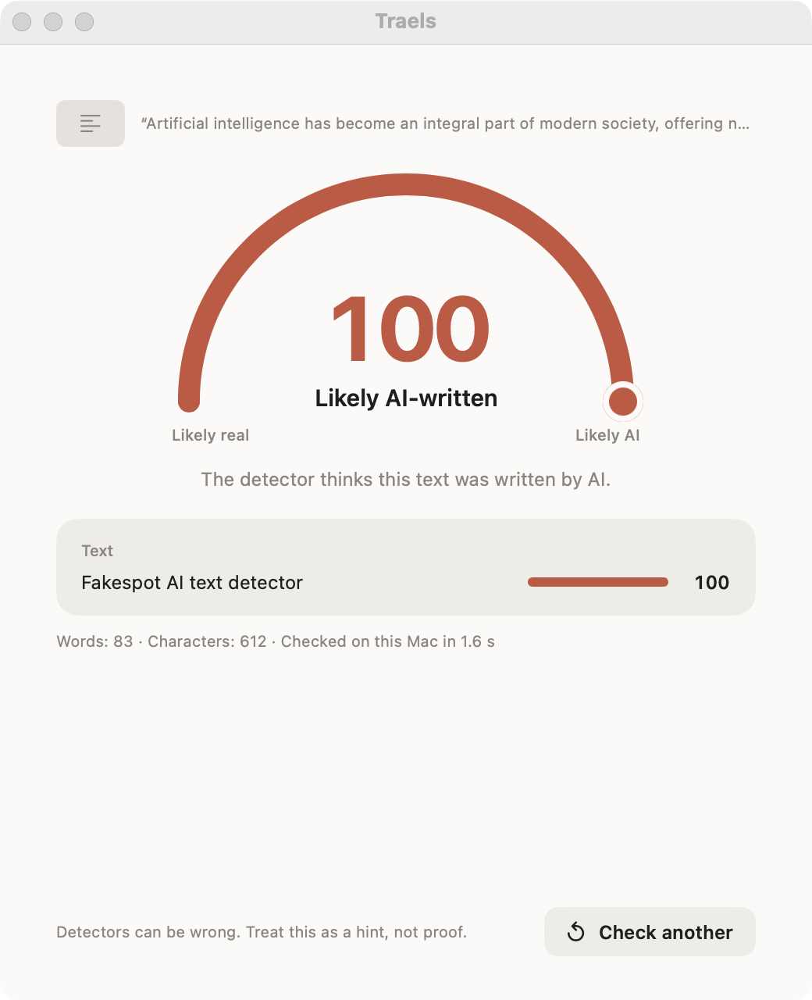
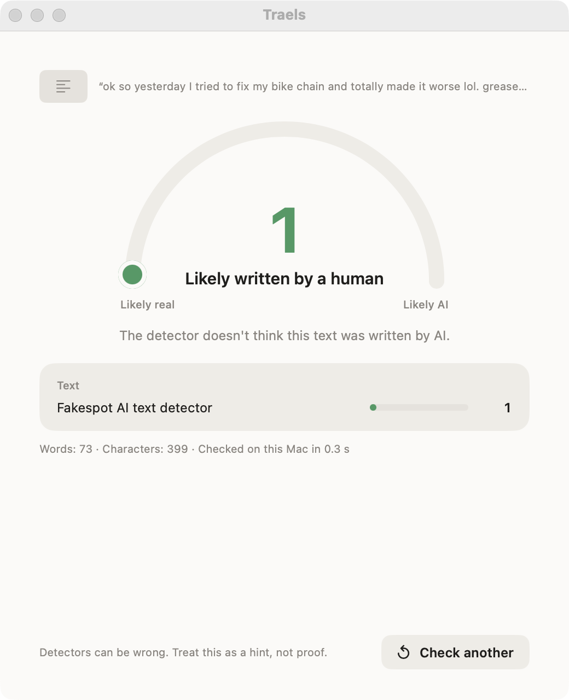
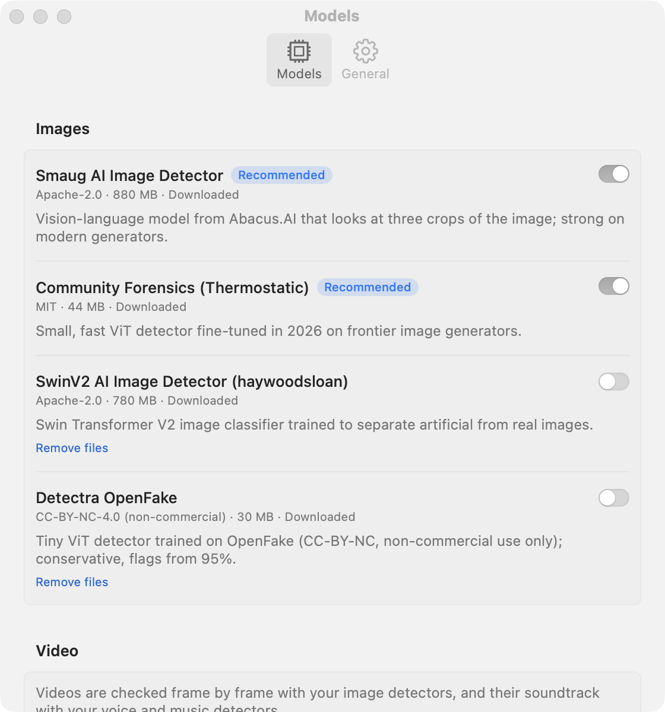

<p align="center">
  
</p>

<h1 align="center">Traels</h1>

<p align="center">
  <strong>Is it AI? A private, on-device checker for images, video, audio and text.</strong>
</p>

<p align="center">
  <a href="LICENSE"></a>
  
  
  
</p>

<p align="center">
  
  
  
</p>

Drop, paste or open an image, a video, a voice note, a song, a link or some text. Traels runs a set of
open-source detection models on your Mac and gives you one 0–100 score for how likely it is to be
AI-generated or fake, with a plain-language summary and a per-model breakdown.

## Why Traels

- **Private by design.** Analysis runs entirely on your Mac. Nothing you check is uploaded.
- **Opt-in models.** No model is downloaded until you switch it on, and you can remove its files again at any time.
- **One clear answer.** Different detectors are put on the same scale and combined into a single score.
- **Shows its working.** Every result lists each model's score, plus cheap non-ML facts such as resolution, EXIF camera and duration.

## Features

- Images, video (frames *and* soundtrack), voice, music and text.
- Drag and drop, paste (⌘V), open (⌘O), drop on the Dock icon, or **Open With → Traels**.
- Paste a link: direct media and pages with `og:image` / `og:video` are fetched automatically.
  Links from YouTube, TikTok, X and similar sites work too, once you turn on **Video sites**.
- Per-model license and size shown before you download anything.

## Install

### Build from source

Requirements: macOS 14+, Xcode 16 / Swift 6, and [uv](https://docs.astral.sh/uv/).

```sh
brew install uv
git clone https://github.com/tommyjepsen/traels.git
cd traels

swift run Traels           # dev run; finds ./backend automatically
# or
scripts/build-app.sh       # builds build/Traels.app with the Python backend bundled
open build/Traels.app
```

The app is ad-hoc signed. If macOS says it can't be opened, right-click the app → **Open**.

### First launch

1. Traels shows *"Setting up the local engine…"* while uv installs the Python dependencies.
   This takes a few minutes, once.
2. Open **Settings (⌘,) → Models** and switch on the detectors you want, or use
   **Turn on recommended**. Each model is downloaded once from the Hugging Face Hub.
3. Drop something on the window.

## Detectors

★ = recommended. All are off until you switch them on.

| Input | Detectors |
|---|---|
| Images | ★ Smaug (Apache-2.0) · ★ Community Forensics / Thermostatic (MIT) · SwinV2 haywoodsloan (Apache-2.0) · Detectra (CC-BY-NC) |
| Text | ★ Fakespot RoBERTa (Apache-2.0, English) · Desklib DeBERTa-v3-large (MIT) |
| Voice | ★ wav2vec2 deepfake voice (Apache-2.0) · mo-thecreator wav2vec2 (Apache-2.0) |
| Music | ★ AST AI-music detector (no license declared) |
| Video | 12 sampled frames through the image detectors + the soundtrack through the voice and music detectors |

Full list with Hugging Face repos, sizes and notes: **[MODELS.md](MODELS.md)**.

<p align="center">
  
</p>

## How the score works

Each detector returns a probability and its own decision threshold. Traels rescales every
probability so the model's threshold sits at 50, averages the models within each signal (picture,
voice, music, text) and reports the **most suspicious signal**, so a cloned voice over real footage
still counts as fake.

| Score | Verdict |
|---|---|
| below 35 | Likely real |
| 35–65 | Can't tell |
| above 65 | Likely AI |

Details, including the worker's JSON-lines protocol, are in **[ARCHITECTURE.md](ARCHITECTURE.md)**.

## Privacy

The network is only used to:

1. download a model once, when you switch it on;
2. download a link you paste or drop (and, with **Video sites** on, via yt-dlp).

Everything else, including all analysis, runs offline (`HF_HUB_OFFLINE=1`). Results aren't stored.

## Limitations

> [!IMPORTANT]
> AI-content detectors are probabilistic and **can be wrong in both directions**. New generators,
> heavy compression, screenshots, re-encoding and very short inputs all make detection harder.
> Treat a Traels score as a hint, not proof, and don't use it as the only basis for decisions
> about people.

- Text detection is English-first and unreliable on short passages.
- Video-site downloads are re-compressed by the platform, which hides artefacts.
- Downloading from video sites may go against their terms of service. That feature is off by
  default and you're responsible for how you use it.

## Project layout

```
Sources/Traels/        SwiftUI app
backend/worker.py      Python inference worker (uv inline-script dependencies)
backend/detectors/     one module per detector family: image, text, audio, music, video
backend/video_sites.py optional yt-dlp downloader, installed only when Video sites is on
scripts/               build-app.sh, make-icon.swift
```

## Contributing

Bug reports, detector suggestions and pull requests are welcome. Adding a Hugging Face classifier
is usually a ~15-line subclass. See **[CONTRIBUTING.md](CONTRIBUTING.md)**.

## License and credits

Traels is released under the [MIT License](LICENSE).

The detection models are **not** included in this repository. They're downloaded from the Hugging
Face Hub on request and stay under their own licenses (see [MODELS.md](MODELS.md)). Detectra is
non-commercial only, and the music model declares no license.

Built with [uv](https://github.com/astral-sh/uv), [🤗 Transformers](https://github.com/huggingface/transformers),
[ONNX Runtime](https://onnxruntime.ai), [PyAV](https://github.com/PyAV-Org/PyAV),
[yt-dlp](https://github.com/yt-dlp/yt-dlp) and [Deno](https://deno.com). Thanks to the authors of
every detector listed in MODELS.md.
